<p align="center">
  
</p>

<h1 align="center">Dumpkin</h1>

<p align="center">
  Host <a href="https://pumpkinmc.org/">Pumpkin</a> Minecraft servers from your Android phone, and manage them from any browser.<br>
  A Material 3 Expressive app, currently in <strong>alpha</strong>. Formerly called AnCraft.
</p>

<p align="center">
  <a href="https://github.com/colebolebole/Dumpkin/releases"></a>
  <a href="LICENSE"></a>
  
  
  
  <br>
  
  
  
  
</p>

<p align="center">
  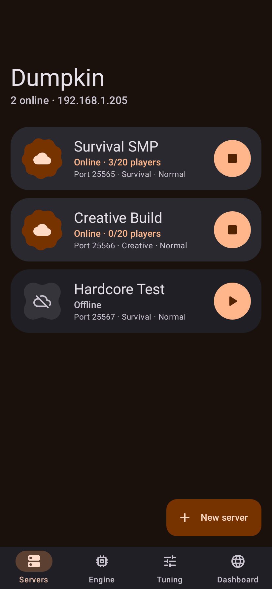
  &nbsp;
  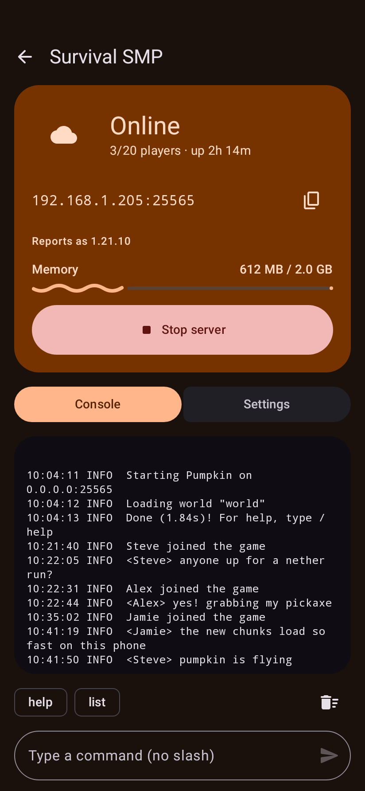
  &nbsp;
  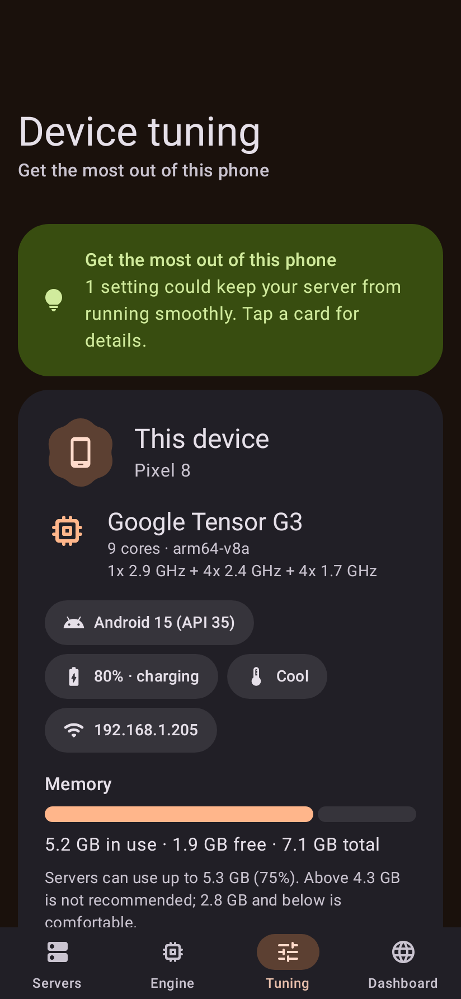
</p>

---

## Features

- **One-tap engine.** Downloads the official `pumpkin-aarch64-android` build (Stable, Canary or Nightly) from Pumpkin's GitHub releases.
- **Web dashboard.** Turn it on and create, start, stop and manage servers from a browser on your PC or another phone: console, every setting, the config file and engine downloads. Password protected (see [Web dashboard](#web-dashboard)).
- **Multiple servers.** Each has its own folder, port, world and `pumpkin.toml`.
- **One-tap restart.** Restart a running server from the app or the web dashboard to apply new settings. It asks first if players are online.
- **Bedrock on every server.** Each server can have its own Bedrock port, so several Bedrock servers run side by side (see [Bedrock servers](#bedrock-servers)).
- **Backups** *(new in 0.6.0)*. Zip a server's whole folder in one tap, restore it later, and save the zip off the phone, from the app or the web dashboard (see [Files and backups](#files-and-backups)).
- **File browser** *(new in 0.6.0)*. Look through a server's folder, open and edit text files such as `ops.json`, make folders, rename and delete, in the app and the dashboard.
- **App updates** *(new in 0.6.0)*. The app checks the Dumpkin releases on GitHub, downloads a newer APK, verifies it and hands it to Android's installer (see [App updates](#app-updates)).
- **Runs in the background.** A foreground service with a wake lock and low-latency Wi-Fi lock keeps servers up, with a "Stop all" button in the notification.
- **Live console.** Send commands and watch players, uptime and RAM use. Tap the command box and the console takes over the whole screen; close the keyboard and everything comes back.
- **Roomy settings.** The status card rolls up as you scroll down the settings and returns as soon as you scroll up.
- **Tuned for phones.** Memory limit, CPU threads, crash auto-restart, and join-speed settings (see below).
- **Device tuning.** A tab that shows your phone's processor, memory, battery and heat, and checks the Android settings that affect hosting (see [Device tuning tab](#device-tuning-tab)).
- **Settings that edit `pumpkin.toml` in place**, plus a raw editor for everything else.
- **Shows the address** players should connect to on your network.

## Install

1. Download `Dumpkin-<version>.apk` from the [Releases](https://github.com/colebolebole/Dumpkin/releases) page.
2. Sideload it on an **arm64** phone running Android 8.0 or newer.
3. Open the **Engine** tab and download a Pumpkin build.
4. Open the **Tuning** tab and deal with anything it flags. Allowing Dumpkin to ignore battery optimisation matters most:
   without it Android can freeze servers when the screen is off.
5. On the **Servers** tab, tap **New server**, then start it. Players on the same Wi-Fi join with the address shown on the server screen.

> [!NOTE]
> **Coming from AnCraft?** The app was renamed and its Android package changed from `app.ancraft` to `app.dumpkin`, so
> Dumpkin installs *next to* AnCraft instead of updating it, and worlds are not migrated. Keep AnCraft until you've
> finished with its servers, then uninstall it. The `0.1.0` and `0.2.0` AnCraft releases were signed with a throwaway
> debug key; Dumpkin releases use a proper release key.

Dumpkin releases share one package name and release key, so a newer APK (for example 0.6.0) installs over any earlier Dumpkin release (0.3.0 or later) and keeps your servers. **0.6.0 is the first release that can update itself** (see [App updates](#app-updates)), so getting to it from an older version is a manual install; after that the app can fetch the next one.

## More screenshots

These are the real screens rendered with sample data (no real servers or players); see [Screenshots](#screenshots)
under Build for how they're made.

**Android app**

<table>
  <tr>
    <td align="center">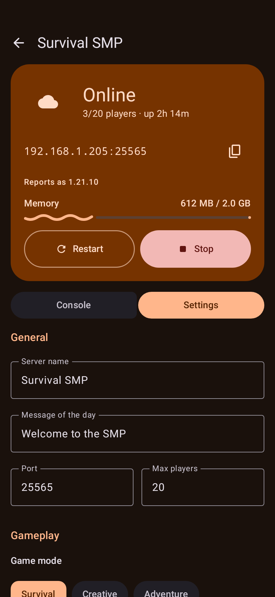<br><sub>Server settings</sub></td>
    <td align="center">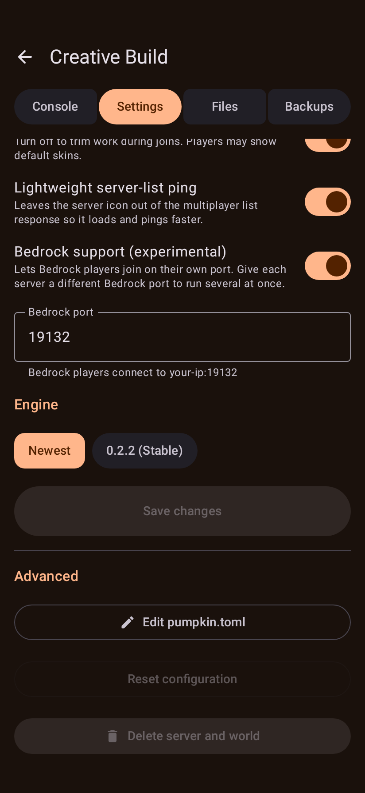<br><sub>Bedrock port per server</sub></td>
    <td align="center">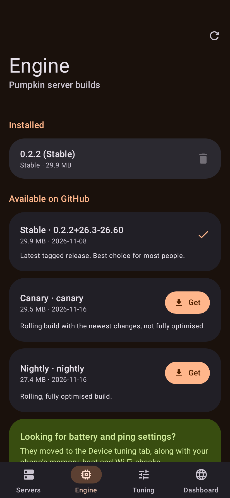<br><sub>Engine builds</sub></td>
    <td align="center">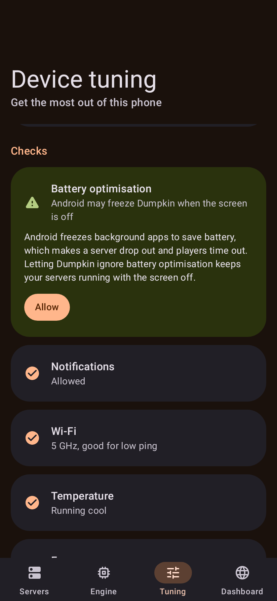<br><sub>Tuning checks</sub></td>
  </tr>
  <tr>
    <td align="center">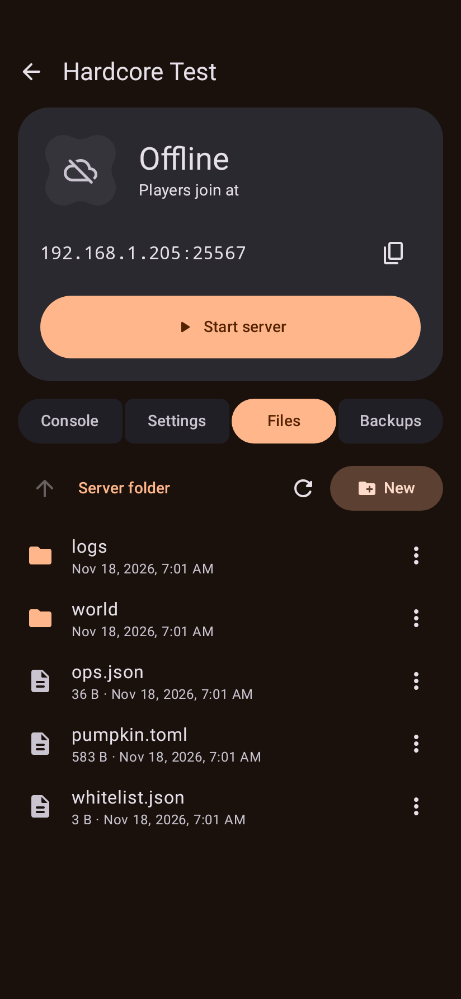<br><sub>File browser</sub></td>
    <td align="center">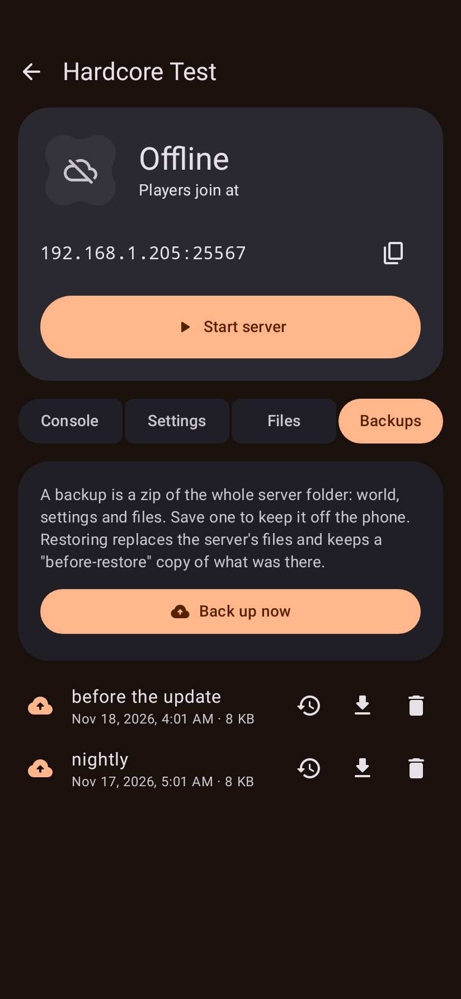<br><sub>Backups</sub></td>
    <td align="center">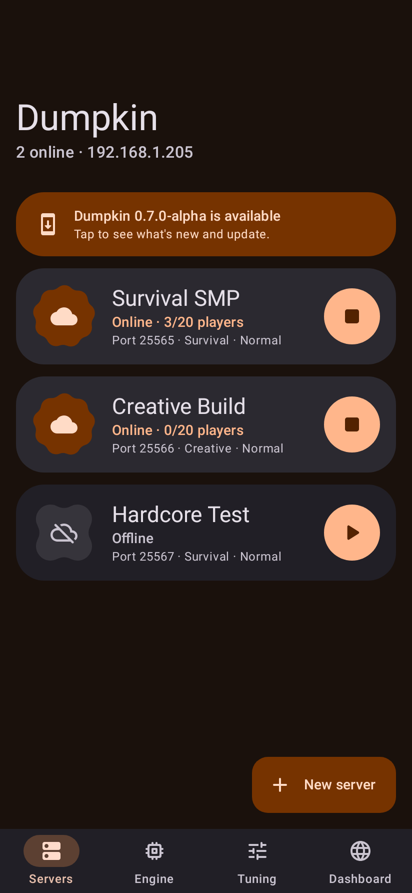<br><sub>Update waiting</sub></td>
    <td align="center">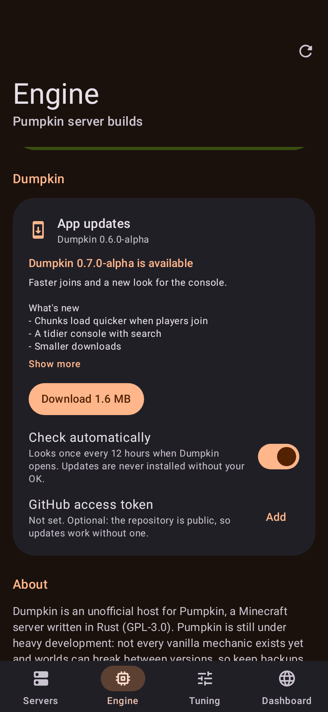<br><sub>App updates</sub></td>
  </tr>
</table>

**Web dashboard**, which is the same app in a browser, on a PC or another phone:

<p align="center">
  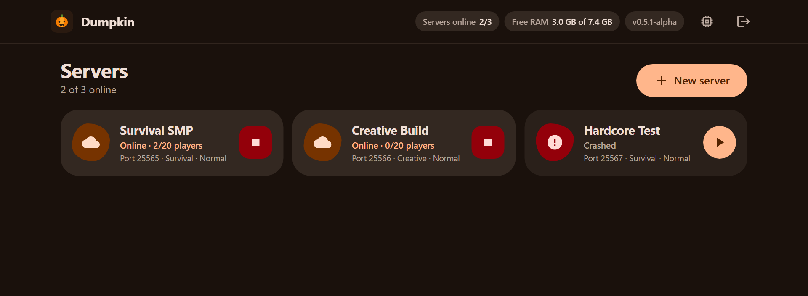
</p>

<table>
  <tr>
    <td align="center">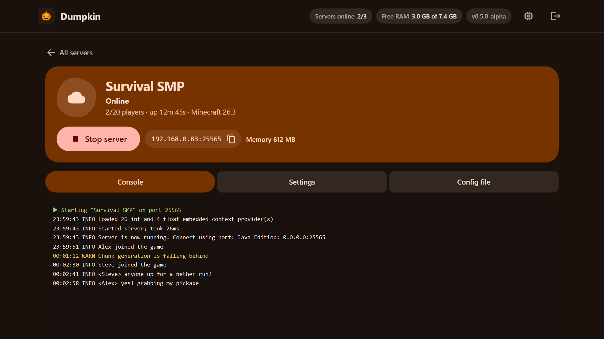<br><sub>Live console</sub></td>
    <td align="center">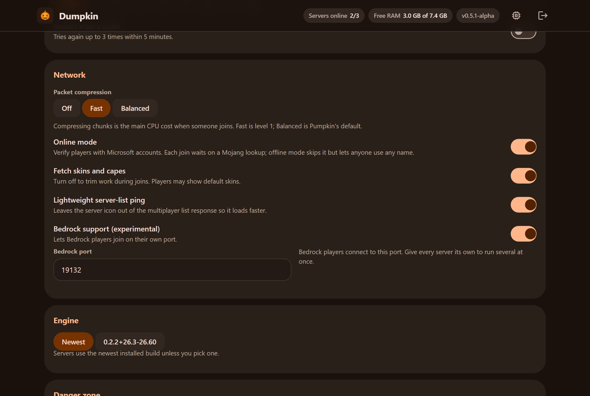<br><sub>Every setting, including the Bedrock port</sub></td>
  </tr>
  <tr>
    <td align="center">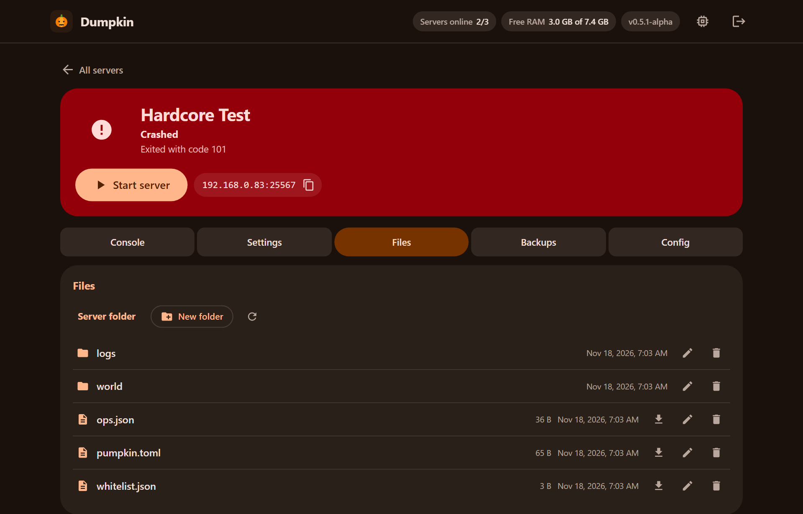<br><sub>File browser</sub></td>
    <td align="center">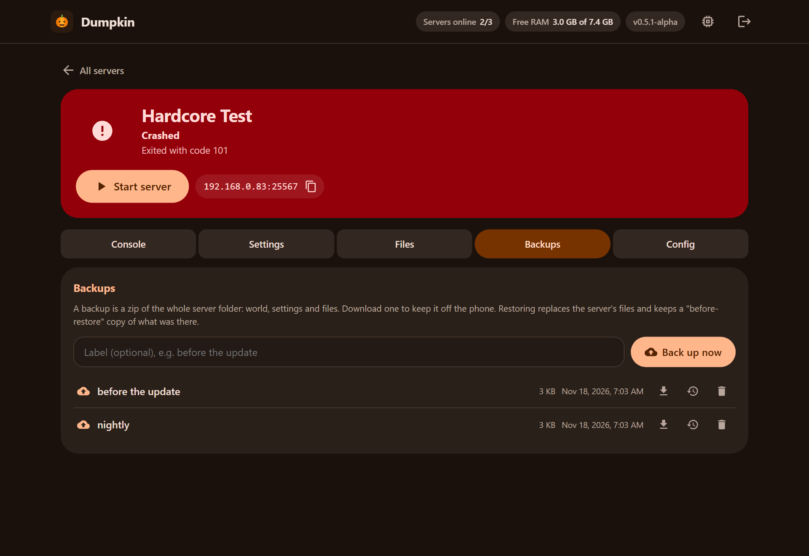<br><sub>Backups: create, download, restore</sub></td>
  </tr>
  <tr>
    <td align="center">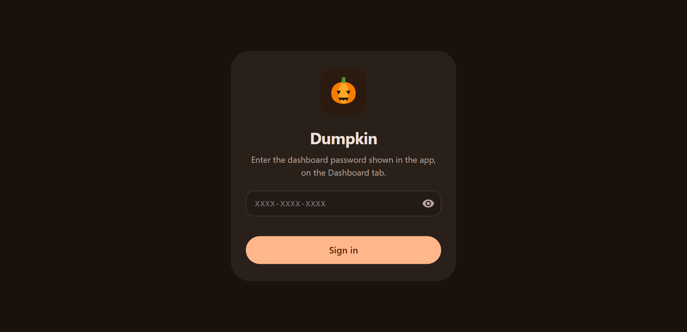<br><sub>Password sign-in</sub></td>
    <td align="center">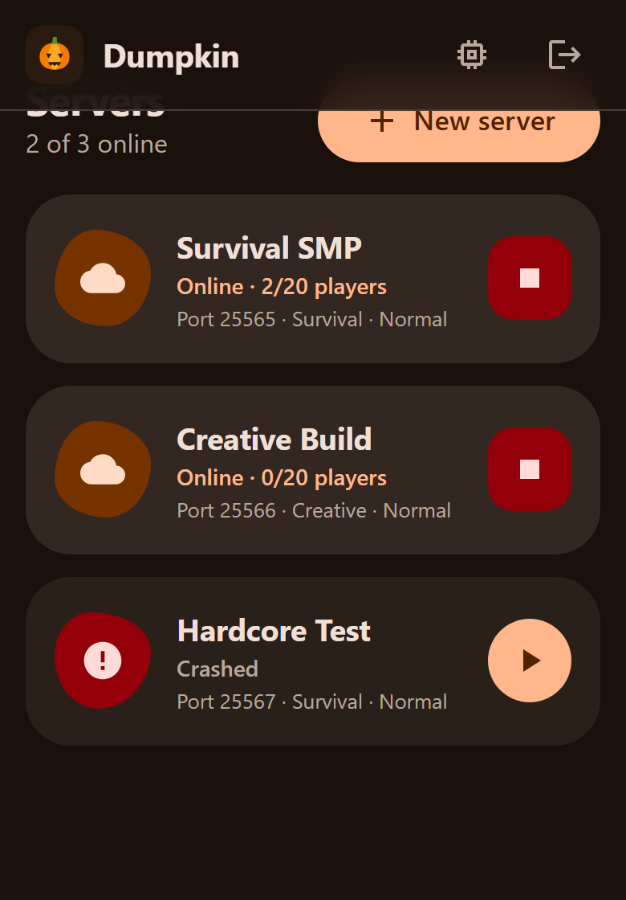<br><sub>Laid out for phones too</sub></td>
  </tr>
</table>

## Web dashboard

Open the **Dashboard** tab in the app and turn the switch on. Dumpkin starts a small web server on your phone (port
`8080` by default). It shows its address, for example `http://192.168.0.83:8080`; open that in a browser on any device on
the same Wi-Fi, sign in with the password from the same tab, and you can:

- create, start, stop, restart and delete servers, with a live status for each
- watch the console and send commands
- change every setting from the table below, and edit `pumpkin.toml` directly
- browse and edit a server's files, and make, download, restore and delete backups (see [Files and backups](#files-and-backups))
- download, update and remove engine builds

It works fully offline (nothing is loaded from the internet), follows your light or dark theme, and is laid out for
phones as well as desktops.

**Security.** The dashboard is plain HTTP meant for your home network, protected by a password:

- A random password is generated for you (`XXXX-XXXX-XXXX`). Change it, or make a new one, from the Dashboard tab; either signs every browser out.
- After 5 wrong passwords an address is locked out for a minute, doubling each time up to 15 minutes.
- Sessions use random 256-bit tokens in `HttpOnly`, `SameSite=Strict` cookies and last a week, or until the app restarts.
- State-changing requests must carry a custom header and a matching `Origin`, and the `Host` header must be an address or local name. These block cross-site requests and DNS rebinding.
- **Don't forward the port to the internet.** Anyone on your Wi-Fi who learns the password can start, stop and delete your servers.
- While the dashboard is on, Dumpkin keeps running in the background (a notification shows it), which uses some battery.

<details>
<summary>JSON API</summary>

Everything the page does goes through a JSON API, so you can script it. Sign in with `POST /api/login`
(`{"password": "..."}`), keep the `dk_session` cookie, and send `X-Requested-With: Dumpkin` on every non-GET request.

| Method and path | What it does |
| --- | --- |
| `GET /api/state` | Phone info, engine builds and every server with its status |
| `POST /api/servers` | Create a server (`name` plus any setting, such as `bedrock` and `bedrockPort`) |
| `GET`, `PATCH`, `DELETE /api/servers/{id}` | Read, change or delete a server (delete only while stopped) |
| `POST /api/servers/{id}/start`, `/stop`, `/restart` | Start, stop or restart it (restarting a stopped server starts it). While a restart is under way the server reports `"restarting": true` |
| `POST /api/servers/{id}/command` | Send a console command (`{"command": "list"}`) |
| `GET /api/servers/{id}/logs?after=N` | Console lines after line `N`; `reset` is true if you must start over |
| `GET`, `PUT /api/servers/{id}/config`, `POST .../config/reset` | Read, write or reset `pumpkin.toml` |
| `GET /api/servers/{id}/files?path=`, `DELETE` the same | List a folder (relative to the server folder), or delete a file or folder |
| `GET`, `PUT /api/servers/{id}/files/content` | Read (`?path=`) or save (`{"path", "text"}`) a UTF-8 text file up to 256 KB |
| `POST /api/servers/{id}/files/mkdir`, `/rename` | Make a folder (`{"path"}`) or rename an item (`{"path", "name"}`) |
| `GET /api/servers/{id}/files/download?path=` | Download a file (always an attachment) |
| `GET`, `POST /api/servers/{id}/backups` | List backups and the running job, or start a backup (`{"label"}`) |
| `POST /api/servers/{id}/backups/{name}/restore`, `DELETE .../{name}`, `GET .../{name}/download` | Restore, delete or download a backup |
| `GET /api/engine`, `POST /api/engine/refresh`, `/download`, `DELETE /api/engine/{id}` | Manage engine builds |

</details>

## Server settings

Open a server and switch to the **Settings** tab. Changes to a running server apply after a restart (use the
**Restart** button on the server screen), except the memory limit, which applies as soon as you save.

| Section | Setting | What it does |
| --- | --- | --- |
| General | Name, MOTD, port, max players | Port must be 1024-65535 and unique across your servers |
| Gameplay | Game mode, difficulty | Written to `default_gamemode` / `default_difficulty` |
| Performance | **Quick pick**: Fast join (6/4), Balanced (8/6), Detailed (12/8) | Sets view and simulation distance together. New servers start on Fast join |
| | View distance (2-24), simulation distance (2-16) | Joining sends every chunk in view distance, so lower values join much faster |
| Resources | **Limit memory** | Soft RAM cap, from 256 MB up to about 75% of the phone's RAM |
| | **When exceeded** | *Warn only* logs a warning; *Restart server* restarts it to free memory |
| | **CPU threads** | Auto, or 1 up to your core count |
| | **Restart after a crash** | Retries up to 3 times within 5 minutes, then gives up |
| Network | **Packet compression** | *Off* (fastest on Wi-Fi, more bandwidth), *Fast* (level 1, default) or *Balanced* (Pumpkin's level 4) |
| | Online mode | Verifies players with Microsoft accounts. Each join waits on a Mojang lookup; offline mode skips it but lets anyone use any name |
| | **Fetch skins and capes** | On by default. Turn off to trim join work; players may show default skins |
| | **Lightweight server-list ping** | On by default. Leaves the server icon out of the multiplayer-list response |
| | Bedrock support, **Bedrock port** | Experimental. Each server has its own Bedrock port (default 19132, then the next free one), so several Bedrock servers can run at once. Set it when creating a server or later in Settings |
| Engine | Build to use | "Newest", or pin a specific installed build |

## Bedrock servers

Bedrock support is experimental in Pumpkin, and off by default. To use it:

1. Turn on **Bedrock support** when you create a server (in the app or the web dashboard), or later in **Settings → Network**.
2. Check the **Bedrock port**. It starts at 19132, then the next free port, so a second Bedrock server gets 19133.
3. Bedrock players join with your phone's address and that port, for example `192.168.0.83:19133`.

Every server needs its own Bedrock port. Dumpkin rejects a port that matches the server's own Java port, or any other
server's Java or Bedrock port. Servers that already used Bedrock keep 19132. The port is written to
`[networking.bedrock.nethernet] address` in `pumpkin.toml`.

## Files and backups

*Available from 0.6.0.* Every server has **Files** and **Backups** tabs next to Console and Settings, in the app and in the web dashboard.

**Files**
- Browse the server's folder, open text files (up to 256 KB, UTF-8) such as `ops.json` or `pumpkin.toml`, edit and save them, make
  folders, rename and delete. In the app, "Save a copy…" writes any file to a place you choose; in the dashboard every file
  has a download button.
- **Changes need the server stopped.** A running server rewrites its own files, and deleting a world under it corrupts it,
  so while it runs you can still look at and download files but not change them (the dashboard returns `409`).
- Everything is confined to the server's own folder. `..`, absolute paths and symlinks that point elsewhere are refused, and
  deleting never follows a symlink. Downloads are always sent as attachments, so a file from a server can't run as a page
  on the dashboard.

**Backups**
- **Back up now** zips the whole server folder (world, settings, files) into `backups/<server>/` in the app's private storage.
  Add a label if you like. It runs in the background with a progress bar. Backing up a running server works, but the world can
  be caught mid-save, so stop it first when you want a guaranteed-consistent copy.
- **Restore** replaces the server's files with the backup. It needs the server stopped, first saves what is there as a
  `before-restore` backup, unpacks into a temporary folder (rejecting any entry that would land outside it), and only then
  swaps it in, so a failed restore leaves your server as it was. The server's current ports and settings are kept.
- **Save it off the phone.** "Save to your files" in the app, or the download button in the dashboard, gives you the plain `.zip`.
  Backups live in the app's storage, so uninstalling Dumpkin deletes them: keep a copy of anything you care about.
- Deleting a server deletes its backups too.

## App updates

*Available from 0.6.0.* The **Engine** tab has an **App updates** card. Dumpkin looks at the releases of this repository on GitHub (when the app
opens, at most every 12 hours, or when you tap **Check for updates**) and shows a banner on the Servers tab when a newer
version is out. **Download** fetches the APK and checks it before offering **Install**:

- its size matches the release, and its SHA-256 matches the one in the release notes when they quote one;
- it is the same app (`app.dumpkin`) signed with the same key as the installed one, so Android will accept it as an update.

Then Android's own installer takes over and asks for your confirmation: nothing is ever installed silently. The first time,
Android asks you to allow Dumpkin to install apps. Installing restarts the app, which stops running servers, so the card warns
you if any are running. Updates only come from GitHub over HTTPS (a redirect anywhere else is refused).

The repository is public, so **no token is needed**: the check works out of the box. The card still has an optional
**GitHub access token** field for two cases: GitHub limits anonymous requests (about 60 an hour, plenty for one check every
12 hours, but shared Wi-Fi networks can use them up), and a token also lets the check work if the repository is ever made
private again (the check then fails with "HTTP 404"). Use a fine-grained personal access token with read-only access to the
repository's *Contents*. It is stored only on the phone and sent only to `api.github.com`, never to the download host.

## Engine tab

- **Installed** and **Available on GitHub** builds, with download progress and delete.
- **Channels.** Nightly builds are fully optimised; Canary skips link-time optimisation and runs slower.

## Device tuning tab

Shows what this phone can do and the settings that decide how well it hosts. It refreshes every couple of seconds.

- **This device.** Model, processor (for example *Snapdragon 8+ Gen 1*), core count and architecture, the speed of each core
  cluster, Android version, battery, heat, and the address players connect to.
- **Memory.** A bar of RAM in use and free, and how much to give servers: up to 75% of the phone's RAM (the same ceiling as
  a server's memory limit), with guidance on what is comfortable.
- **Checks.** A banner counts the settings that could hold your server back, and each card opens to an explanation and a
  button that takes you to the right Android screen:
  - **Battery optimisation.** Android freezes background apps, so allow Dumpkin to ignore it or servers drop out when the screen is off.
  - **Notifications.** Needed to see running servers and use the Stop all button.
  - **Wi-Fi.** Flags 2.4 GHz (use 5 GHz for lower ping) or no network address.
  - **Temperature** and **free memory.** Hot or low-memory phones throttle or lose background apps.
- **Hosting.** **Keep screen on while hosting**: Android only grants its low-latency Wi-Fi mode while the screen is on, so
  this gives players the lowest ping at the cost of battery. Plug the phone in.
- **Developer options & system.** Shortcuts to Android's battery, Wi-Fi, developer options and app info screens.

## How it works

- **Memory limit.** Pumpkin is native Rust code with no JVM-style `-Xmx` heap, so Dumpkin reads the server's resident
  memory (`VmRSS` in `/proc/<pid>/status`) every 2 seconds. If it stays over the limit for two samples in a row, the chosen
  action runs. It is a soft limit, not a hard cap, and needs the process id, which some devices may not expose.
- **CPU threads.** Sets `TOKIO_WORKER_THREADS` and `RAYON_NUM_THREADS` for the server process. Whether Pumpkin honours
  them is unconfirmed.
- **Readiness and player count.** Dumpkin uses the standard Minecraft status ping against the local port: every 250 ms
  while starting, so "Online" appears as soon as the port opens, then every 10 seconds.
- **Console.** Output is published in batches instead of rebuilding the log list per line, which matters during the startup burst.
- **Wi-Fi lock.** Uses the low-latency mode on Android 10+ (the old high-performance mode does nothing on Android 14+).
- **Device tuning readings.** The processor name comes from `Build.SOC_MODEL` (Android 12+) and a small table of Snapdragon
  codes, falling back to whatever the phone reports. Core speeds come from `/sys/devices/system/cpu/*/cpufreq`, so the line
  is missing on phones that block it. Heat uses Android's thermal status (Android 10+) or the battery temperature on older
  phones, and the Wi-Fi band comes from the connection's frequency.
- **Why `targetSdk = 28`.** The engine is downloaded at runtime and run from app storage, which Android 10+ forbids for
  apps targeting API 29+. Like Termux, Dumpkin targets 28 and is meant to be sideloaded rather than published on Play. If a
  device still refuses a direct exec, the runtime retries through `/system/bin/linker64`.

## Build

Requires JDK 17+ and the Android SDK (platform 36), or just Android Studio. The Gradle wrapper is checked in.

```bash
./gradlew assembleDebug        # app/build/outputs/apk/debug/app-debug.apk
./gradlew assembleRelease      # minified; signed with the release key if configured (see below)
./gradlew testDebugUnitTest    # config patcher, validation, web server and API, login security, UI smoke tests
```

The web server is tested end to end over real sockets against a fake backend, so no phone is needed. To look at the
dashboard UI the same way, run the preview (it serves the real server and web files for 20 minutes) and open
`http://127.0.0.1:18080`, password `preview-1234`:

```bash
DUMPKIN_PREVIEW=1 ./gradlew testDebugUnitTest --tests '*WebPreview*' -i
```

The dashboard's HTML, CSS and JS live in `app/src/main/assets/web/` and are plain files with no build step.

### Screenshots

The images in `docs/screenshots` are generated, not hand-edited, and show sample data only:

- **Android screens** are the real Compose UI rendered under Robolectric, with a made-up phone, servers and console log.
  Material You colours are switched off so you get Dumpkin's own palette.

  ```bash
  DUMPKIN_SCREENSHOTS=1 ./gradlew testDebugUnitTest --tests '*Screenshots*' --rerun
  ```

- **Web dashboard** shots are taken with headless Chrome against the preview above (Windows, needs Chrome):

  ```bash
  powershell -ExecutionPolicy Bypass -File tools/capture-web-screenshots.ps1
  ```

### Release signing

Release builds are signed with a private key that is **not** in this repository.

1. Create a keystore once (keep it outside the repo):

   ```bash
   keytool -genkeypair -keystore ~/.dumpkin/dumpkin-release.jks -storetype PKCS12 -alias dumpkin \
     -keyalg RSA -keysize 4096 -validity 10950 -dname "CN=Dumpkin"
   ```

2. Copy `keystore.properties.example` to `keystore.properties` (git-ignored) and fill in the path and passwords, or set the
   `DUMPKIN_KEYSTORE_FILE`, `DUMPKIN_KEYSTORE_PASSWORD`, `DUMPKIN_KEY_ALIAS` and `DUMPKIN_KEY_PASSWORD` environment variables.
3. Build with `./gradlew assembleRelease -PrequireReleaseKey`. That flag makes the build fail if the key is missing,
   instead of quietly falling back to the debug key (which is what happens without it, with a warning, so contributors
   can still build an installable APK). Never publish a fallback build.
4. Check the result with `apksigner verify --print-certs app-release.apk`: the signer should be `CN=Dumpkin`.

> [!IMPORTANT]
> **Back up the keystore file and its passwords** (for example in a password manager). Android only installs an update
> if it is signed with the same key as the installed app, so if the key is lost, every user has to uninstall and
> reinstall, losing their servers. Don't commit the key or `keystore.properties`.

Material 3 is pinned to `1.5.0-alpha10`: the Expressive APIs aren't public in 1.4.0 stable, and newer 1.5 builds need
Android Gradle Plugin 9+. Expect some API churn when you bump it.

## Notes

- Pumpkin is under heavy development and not every vanilla mechanic exists yet. **Keep backups of your worlds.**
- If a server won't start after changing settings, use **Reset configuration** (Settings → Advanced). Key names come from
  Pumpkin's docs and may change between versions.
- Pumpkin ignores unknown keys, but a value of the wrong type resets the whole config to defaults, so Dumpkin only writes
  documented keys with values inside the documented ranges.

<details>
<summary>Keys Dumpkin writes to <code>pumpkin.toml</code></summary>

- Top level: `default_gamemode`, `default_difficulty`, `use_favicon`
- `[networking.java]`: `address`, `online_mode`, `max_players`, `view_distance`, `simulation_distance`, `motd`
- `[networking.java.compression]`: `enabled`, `level`
- `[networking.java.authentication.textures]`: `enabled`
- `[networking.bedrock]`: `enabled`
- `[networking.bedrock.nethernet]`: `address` (`0.0.0.0:<bedrock port>`)
- `[commands]`: `use_tty = false`
- First run only, all set to `false`: `[telemetry]`, `[networking.query]` and `[networking.management]` `enabled`

</details>

## License

Dumpkin is released under the [MIT License](LICENSE).

## Credits

Dumpkin is an unofficial project and is not affiliated with Pumpkin, Mojang or Microsoft. Pumpkin is licensed GPL-3.0;
Dumpkin does not include or link against it, it only downloads the released binary at runtime and runs it as a separate
process, so the MIT license covers Dumpkin's own code and Pumpkin stays under its own license.
